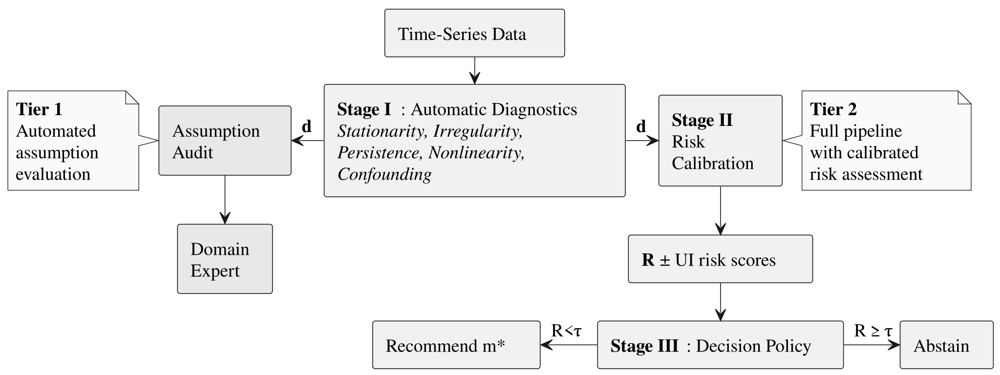

# Causal-Audit - Framework, Figures & Benchmarks

This document collects the paper-oriented material for Causal-Audit: the generated figure catalogue, the synthetic DGP atlas used for calibration and benchmarking, the framework extension points, and the commands to reproduce the paper experiments. For installation and day-to-day usage, see the [README](../README.md).

<p align="center">
  
</p>

## Generated Figures

By default, `gk.analyze()` produces six diagnostic figures (300 DPI, PDF+PNG) in
`output_dir/figures/`. Figure generation failures are reported in the run output.
An exploratory discovery graph is available through the explicit opt-in below.

| Figure | Description |
|--------|-------------|
| `prediscovery_summary` | Composite (panels a-e): time series overview, risk profile with approximate uncertainty bounds, ACF with T_eff, held-out RF/linear prediction comparison, recommendation or abstention |
| `correlation_and_lagged_crosscorrelation` | Contemporaneous Pearson correlation + max lagged cross-correlation matrices |
| `spectral_density` | Power spectral density per variable with dominant period and power fraction |
| `stationarity_diagnostic` | Rolling mean/std with ADF+KPSS verdict in causal discovery language |
| `sample_size_adequacy` | Effective sample size per variable vs. method minimum requirements |
| `assumption_deep_dive` | Per-assumption diagnostic (6 panels) with evidence and recommended action |
| `dependency_network` (opt-in) | Exploratory PCMCI+ graph with ParCorr, tau_max=2, via Tigramite; skipped on abstention |

Style is configurable via `DEFAULT_STYLE` in `causal_audit/plotting/figures.py`.
Options: `"ieee"` (default), `"science"`, `"nature"`. Install SciencePlots for these
styles; otherwise plotting falls back to the default Matplotlib style.

```python
# Runs optional exploratory discovery as well as the audit; requires Tigramite.
result = gk.analyze(df, output_dir="results/", include_dependency_network=True)
```

This graph uses raw data and a short lag horizon. It does not execute the policy's
proposed preprocessing or configuration and is not a validation of causal relationships.
Default auditing performs no causal discovery.

### Interpreting the nonlinearity diagnostic

The figures show the relative RMSE improvement of a random forest over a
linear autoregression on chronological validation splits. This is a
predictive diagnostic, not a hypothesis test or a classification of causal
edges. The binned MI/correlation summaries remain available for inspection,
but their former nonlinear flags, fractions, and CI recommendations are
`null`: the MI/r² threshold generated false alarms even on independent
Gaussian data. The calibrated risk model already gives that fraction zero
weight. Plotting suggestions now refer to the actual policy recommendation.

## Synthetic DGP Atlas ([Zenodo](https://zenodo.org/records/19409395))

500 synthetic multivariate time series with controlled assumption violations, designed for benchmarking causal discovery pre-processing and method selection. All families share a VAR(1) base process. Generated 2025-11-30, seed 42.

| Family | Name | Domain | n | N | T | Start date | End date | Violation mechanism | Severity |
|--------|------|--------|---|---|---|------------|----------|---------------------|----------|
| F1 | Clean baseline | Synthetic VAR(1) | 50 | 5–8 | 500–1000 | 2020-01-01 | 2021-05-15 – 2022-09-27 | None | ρ(A) ≤ 0.7 |
| F2 | Structural breaks | Synthetic VAR(1) with regime changes | 50 | 5–8 | 500–1000 | 2020-01-01 | 2021-05-15 – 2022-09-27 | 1–3 regime changes in VAR coefficients | Continuous |
| F3 | Irregular sampling | Synthetic VAR(1) with missingness | 50 | 5–8 | 500–1000 | 2020-01-01 | 2021-05-15 – 2022-09-27 | MCAR / MAR / seasonal gaps | 15–35 % missing |
| F4 | High persistence | Synthetic near-unit-root VAR(1) | 50 | 5–8 | 500–1000 | 2020-01-01 | 2021-05-15 – 2022-09-27 | Near-unit-root spectral radius | ρ(A) ∈ [0.92, 0.98] |
| F5 | Latent confounders | Synthetic VAR(1) with hidden causes | 50 | 5–8 | 500–1000 | 2020-01-01 | 2021-05-15 – 2022-09-27 | L ∈ {1, 2} hidden common causes | σ_conf ∈ {0.3, 0.6, 0.9} |
| F6 | Seasonality | Synthetic VAR(1) with harmonic components | 50 | 5–8 | 500–1000 | 2020-01-01 | 2021-05-15 – 2022-09-27 | Additive harmonic components | P ∈ {12, 24, 52} |
| F7 | Nonlinear | Synthetic nonlinear dynamics | 50 | 5–8 | 500–1000 | 2020-01-01 | 2021-05-15 – 2022-09-27 | tanh / sin / ReLU transforms | Moderate |
| F8 | Non-Gaussian | Synthetic heavy-tailed VAR(1) | 50 | 5–8 | 500–1000 | 2020-01-01 | 2021-05-15 – 2022-09-27 | Student-t or Laplace noise | ν ∈ {3, 5, 10} |
| F9 | Mixed violations | Synthetic multi-violation VAR(1) | 50 | 5–8 | 500–1000 | 2020-01-01 | 2021-05-15 – 2022-09-27 | 2–3 families combined | Multiple high |
| F10 | Boundary cases | Synthetic stress-test VAR(1) | 50 | 3–12 | 200–2000 | 2020-01-01 | 2020-07-19 – 2025-06-23 | Short series / high-dim / sparse / near-unit-root | Stress test |

Generator: `causal_audit_validation/generators/synthetic_atlas_extended_v02.py`.

## Extending

Each stage has a single extension point.

**New method.** Add to `config/method_catalog.yaml`:

```yaml
LPCMCI:
  full_name: "Latent PCMCI"
  citation: "Gerhardus & Runge (2020)"
  implementation: "tigramite"
  assumptions:
    stationarity: { tolerance: "soft", penalty_weight: 0.5 }
    causal_sufficiency: { tolerance: "none" }   # handles latent confounders
  parameters: { tau_max: "data_driven", pc_alpha: 0.01 }
```

Then register its risk thresholds in `c_recommender.py`:

```python
# In METHOD_CONSTRAINTS:
"LPCMCI": {
    "hard_constraints": [
        ("NonstationarityRisk", 0.80, "Requires weak stationarity"),
    ],
    "soft_constraints": [
        ("ConfoundingRisk", 0.90, "Handles latent confounders via PAGs"),
        ("PersistenceRisk", 0.85, "Large tau_max needed"),
    ],
    "base_cost": 2.0,
}
```

**New diagnostic.** Add a method to `a_auditor.py` and wire it in `audit()`:

```python
# In AssumptionAuditor:
def check_measurement_noise(self, df):
    results = {}
    for col in df.columns:
        series = df[col].dropna().values
        # e.g. ratio of high-frequency variance to total variance
        results[col] = {"hf_variance_ratio": float(...)}
    return results


# In audit():
diagnostics["measurement_noise"] = self.check_measurement_noise(df)
```

**New risk dimension.** Three edits: append to `CORE_RISKS` in `b_quantifier.py`, add extraction in `_extract_diagnostic_values()`, and add weights in `calib_v2.yaml`:

```yaml
# In global_parameters.risks:
MeasurementNoiseRisk:
  alpha: -2.0
  diagnostic_weights:
    hf_variance_ratio: { weight: 3.0 }
```

**Recalibrate.** Run your DGPs through Stage I, fit new models, freeze to YAML, and point the gatekeeper to it: `RiskAwareGatekeeper(calib="calib_v3.yaml")`. Scripts: `causal_audit_validation/calibration_v02/`.

See `../docs/threat_model.md` for what the framework cannot detect.

## Reproducing paper experiments

```bash
# 1. Synthetic Atlas: generate 500 DGPs, run calibration, cross-validate
python causal_audit_validation/generators/synthetic_atlas_extended_v02.py
python causal_audit_validation/calibration_v02/run_full_atlas_calibration_v02.py
python causal_audit_validation/calibration_v02/run_cross_validation.py

# 2. TimeGraph benchmark (18 categories)
python timegraph_validation/run_validation_v3_final.py

# 3. CausalTime benchmark (3 domains)
python causaltime_validation/run_causaltime_validation.py
```
